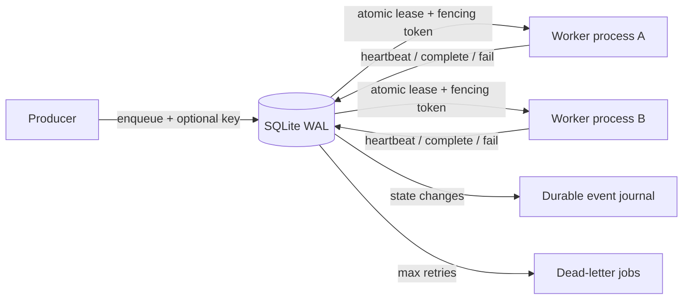

# LeaseLedger

**Durable job processing with fenced leases and crash recovery — designed for multiple worker processes on one host.**

LeaseLedger is a small, auditable Python library and CLI that uses SQLite Write-Ahead Logging (WAL) for an **at-least-once** task queue. It emphasizes difficult correctness problems—stale-worker acknowledgements, crash recovery, idempotent submissions, backoff, and dead-letter handling—without introducing Redis, Kafka, cloud accounts, or a hosted control plane.

**Scope:** single-host/multi-process. SQLite on NFS or across servers is **not supported**. The queue does not promise exactly-once side effects, production distributed consensus, or arbitrary-code sandboxing.

## Why this exists

A naïve background-job runner loses tasks on crash and can let an expired worker acknowledge work after another worker has reclaimed it. LeaseLedger solves the local durable-queue version of these problems using one serialized write transaction for claims and a monotonically increasing **fencing token** on every claim.

| Feature | Behavior |
| --- | --- |
| Durable queue | SQLite WAL + indexed scheduled jobs |
| Multiple worker processes | Atomic `BEGIN IMMEDIATE` claim, no double active lease |
| At-least-once processing | Crashed jobs become claimable after the lease expires |
| Fencing tokens | Expired/replaced workers cannot complete, fail or extend a reclaimed lease |
| Idempotency keys | Atomic deduplication of producer submissions |
| Scheduled and prioritized jobs | Delayed readiness, priority, FIFO tie breaks |
| Backoff and dead-letter | Bounded exponential retry; final failures persist for inspection |
| Worker heartbeat | Extends a lease while the trusted handler works |
| Event journal | Enqueued, claimed, heartbeat, retry, dead, completed, requeued |
| Operational CLI | Enqueue, work, get, events, stats, dead-letter requeue, verify and backup |
| Verifiable correctness | Deterministic fake-clock tests, real multi-process race test and worker tests |

## Quick start

Requires Python 3.11+ and a **local** filesystem. The runtime has no third-party dependencies.

```bash
git clone https://github.com/harshitethic/LeaseLedger.git
cd LeaseLedger
python3 -m pip install -e .
leaseledger --db jobs.db init
leaseledger --db jobs.db enqueue receipt '{"order_id":"A42"}' --key order-A42
leaseledger --db jobs.db work --handler examples.handlers:print_receipt --once
leaseledger --db jobs.db stats
```

The example worker prints an event to stderr, and the CLI returns a JSON summary on stdout. The database is created with private `0600` file mode on Unix when possible.

## One-command verified recovery demo

From a source checkout, run the [working offline demonstration](docs/reproducible-demo.md):

~~~bash
python3 -m examples.recovery_walkthrough
~~~

The script creates an actual temporary SQLite database, checks producer
deduplication, reclaims an expired lease with a new fencing token, rejects
the previous owner's stale ACK, and verifies a consistent online backup
and event journal. The exact output is checked into
[recovery-demo-output.json](docs/recovery-demo-output.json) and compared
against the command by automated tests on Python 3.11–3.13.
**No third-party services are used or claimed.**

## Python API

```python
from leaseledger import Store

queue = Store("jobs.db")
result = queue.enqueue(
    "payments.reconcile", {"payment_id": "p-123"},
    key="reconcile-p-123", max_attempts=3,
)

lease = queue.claim("worker-01", lease_seconds=30)
if lease:
    try:
        # Run a trusted, idempotent handler here.
        reconcile(lease.payload)
    except Exception as exc:
        queue.fail(lease, type(exc).__name__, base_delay=2)
    else:
        if not queue.complete(lease):
            # The lease expired or was reclaimed: do not assume exclusive ownership.
            raise RuntimeError("Lost lease; reconcile outcome before retry")
```

The `Worker` helper runs an automatic heartbeat thread. It does not execute a user-selected shell command or provide isolation for third-party Python modules.

## Architecture



Read the [lease expiry during writer contention analysis](docs/notes/lease-expiry-after-lock.md).

Read the [100-expired-leases failure analysis](docs/notes/expired-lease-cleanup-progress.md).

Read [correctness and design decisions](docs/architecture.md), [why SQLite](docs/adr/0001-sqlite.md), and the technical deep dive [why a lease needs fencing tokens](docs/notes/why-fencing-tokens.md). The audit history is persisted in the same transaction as state transitions.

## Tests and real concurrency evidence

```bash
python3 -m unittest discover -s tests -v
python3 -m compileall -q leaseledger
```

The multiprocess tests start **four separate Python processes**, have them
compete for **48 jobs** using one on-disk SQLite database, and verify each job
completes once in that no-fault run. A separate test **abruptly terminates a
worker process** after a claim and verifies the expired job is reclaimed with a
new fence. These tests **do not imply exactly-once external side effects**.

GitHub Actions runs the suite (40 queue tests plus eight release-publication tests, including a seeded 640-operation reference model) against Python 3.11, 3.12 and 3.13: [view CI](https://github.com/harshitethic/LeaseLedger/actions/workflows/ci.yml).

## Online backup and recovery

SQLite WAL databases must not be copied with cp while workers are active.
LeaseLedger provides a consistent online snapshot, never overwrites an existing
backup, and verifies pages and foreign-key relationships:

~~~bash
leaseledger --db jobs.db verify
leaseledger --db jobs.db backup /secure-backups/jobs-snapshot.db
leaseledger --db /secure-backups/jobs-snapshot.db verify
~~~

Read the [backup and recovery runbook](docs/backup-and-recovery.md) for
permissions, integrity checks, restoration precautions, WAL behavior and
at-least-once replay implications. This is a manual backup command, not
a hosted or automatically scheduled backup service.

## Reproducible benchmark

```bash
python3 -m benchmarks.queue_bench --jobs 1000 --workers 4
```

The script reports measured enqueue and completion throughput on **your machine** and checks the final queue counts. The [14 October 2026 cross-platform verification](benchmarks/VERIFICATION-2026-10-14.md) records real, one-run measurements on an Intel/Kali and Apple M1/macOS device, including a large difference in throughput. Those **minimal no-op workload** results are not production capacity, an apples-to-apples CPU comparison, or a service-level objective.

## Limitations

- **At-least-once, not exactly-once:** a worker can perform an external side effect and crash before `complete()`. Use downstream idempotency keys and reconciliation.
- **Single host:** SQLite locking and WAL require a reliable local filesystem. It is not a multi-region queue or a Kafka substitute.
- **Trusted handlers:** handler code runs with the worker process's OS permissions; use an external sandbox before accepting untrusted handler modules.
- **Resource scale:** this design opens a SQLite connection per operation and uses a single writer. Benchmark and profile real workloads before scaling; a broker/server is appropriate at larger volumes.
- **Wall-clock leases:** NTP jumps and host clock changes can affect timeouts. Use appropriately long leases and monitor host clock health.
- **Operational hardening:** no hosted API, authentication service, encryption at rest, tracing backend, distributed consensus or Kubernetes controller is claimed.

## Releases

Main-branch releases are published only after the full CI matrix, packaging,
benchmark smoke, lint and CodeQL gates pass. The release job checks matching
versions and changelog notes and never moves an existing version tag.
See the [release workflow and recovery procedure](docs/releases.md).

## Collaboration

See [CONTRIBUTING.md](CONTRIBUTING.md), [SECURITY.md](SECURITY.md), [the architecture](docs/architecture.md) and [GitHub issues](https://github.com/harshitethic/LeaseLedger/issues). Meaningful contributions—especially reproducible concurrency bugs, cross-platform test coverage and new safety checks—are welcome.

Licensed under [MIT](LICENSE).
