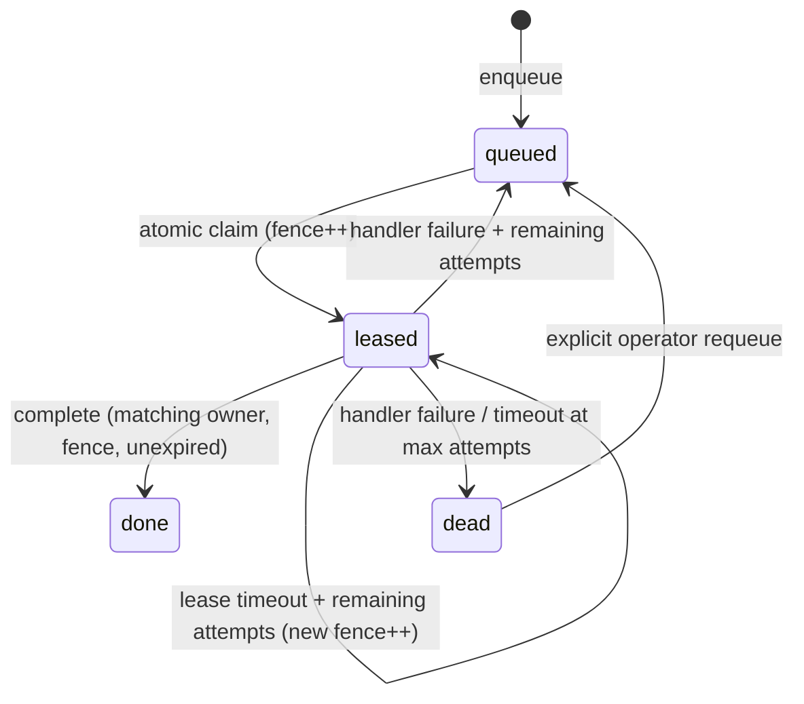

# Architecture and correctness

## State machine

### Invariants

1. **Single active ownership in the queue:** `BEGIN IMMEDIATE` serializes claim transactions. Exactly one committed claim can return a given lease version. Older owners have stale fencing numbers.
2. **Stale acknowledgements do not mutate state:** heartbeat/complete/fail check `job_id`, `owner`, current `fence`, `status='leased'`, and `lease_until > now`.
3. **Crash recovery:** a leased job becomes selectable when `lease_until <= now`. If max attempts were already used, it transitions to `dead` instead.
4. **Idempotent producer requests:** `dedupe_key` is UNIQUE, and insert+existing ID lookup occurs in one transaction. Key lifetime is the entire retained record, including dead/done.
5. **Observable transitions:** event insert and state change share a transaction. Interrupted operations roll back, so there is no committed state without its journal entry.

## Failure scenarios

| Scenario | Expected behavior |
| --- | --- |
| Process crashes before a claim commits | Transaction rolls back; job remains claimable |
| Worker crashes while processing | Job is reclaimable after lease expiry; new fence |
| Old worker resumes after reclaim | Old fence rejected by complete/fail/heartbeat |
| Handler returns success, then worker crashes before ack | Possible duplicate external effect; use downstream idempotency |
| DB is busy due to another writer | SQLite busy timeout (15 seconds); retry at application boundary |
| Job exceeds max attempts | Persistent dead-letter record and event |
| Producer retries same dedupe key | Existing ID returned; payload is not silently replaced |
| Worker handler takes longer than lease | Background heartbeat extends the lease; failure is detectable |

## Performance and availability considerations

- SQLite WAL lets readers access persisted data while a writer commits; there is still only **one writer** at a time.
- `jobs_ready` and `jobs_leases` are indexed for candidate selection. Load-test the actual active/expired mix at scale.
- The claim transaction may transition up to 100 expired/maxed jobs to dead-letter; the next claim resumes. This avoids an unbounded transaction and still drains poisoned records over repeated calls.
- Backoff is `min(max_delay, base_delay * 2 ** (attempts - 1))`, bounded to avoid overflow.
- Claims are not reservations of CPU time: worker and handler scheduling are OS-controlled.
- Leases use a stored Unix timestamp, not a monotonic timer, so restarting processes preserves expiration, at the cost of clock-skew sensitivity.
- Event journal growth is unbounded in v0.1; add an explicit retention/archival policy before large-scale deployment.

## Why not Redis, RabbitMQ or Kafka?

See [ADR-0001](adr/0001-sqlite.md). This project demonstrates concurrency, transaction and state-machine design without pretending to provide cross-host consensus. For workloads requiring geographic distribution, high throughput, durable cross-node replication, or managed operations, use a production broker or Postgres-based design with corresponding tests.

## Security boundaries

Job payloads and errors are stored in a local SQLite database. **Do not store credentials or regulated personal data** without encryption and access policies. The CLI imports a local Python handler specified by an operator. That module may execute arbitrary code: treat it like running any trusted program, not as sandboxed tenant code.
