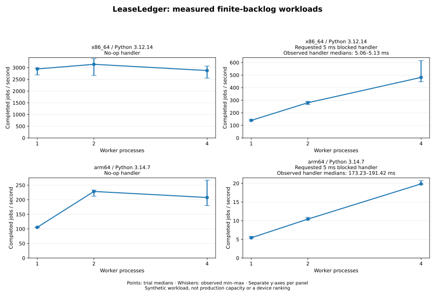

# Repeated workload measurements

The original benchmark is a useful no-op smoke test, but one throughput number
cannot explain contention, retries or tail latency. `benchmarks.workload_bench`
adds repeated finite-backlog experiments using the real `Store` API and spawned
OS processes. It requires only Python 3.11+ and a source checkout containing
this script. Existing v0.1.3 source archives predate this benchmark addition.

## Reproduce

```bash
python -m benchmarks.workload_bench --jobs 300 --workers 1,2,4 --handler-ms 0,5 --repeats 5 --retry-every 10 > workload.json
python -m unittest tests.test_workload_benchmark -v
```

Every trial uses a new temporary SQLite database, preloads 300 jobs, initializes
all workers, then opens a shared start barrier. Each payload has a 512-byte
body plus its job number and enqueue timestamp. Zero-delay handlers do no
business work. Delayed handlers request a five-millisecond sleep to model
blocked I/O; they do not call a real API. Actual observed handler duration is
recorded separately because scheduling can extend a requested sleep. Every tenth
job fails its first attempt with zero retry backoff, then completes on its second
attempt. Each configuration is repeated
five times. There is no discarded warm-up run.

These experiments use direct claim/fail/complete calls, not `Worker`'s heartbeat
thread. Each lease lasts 60 seconds. An expired ACK or retry aborts the trial;
it is not silently excluded from the statistics. Other runs can vary jobs,
worker counts, delays, retries and the per-trial worker deadline.

## What each number means

| Field | Measurement |
| --- | --- |
| `enqueue_seconds` | Time to preload every job, including JSON encoding and queue writes |
| `startup_seconds` | Spawn through all worker-ready markers, including worker Store initialization |
| `drain_seconds` | Barrier release through the final worker's last empty claim; excludes startup and report serialization |
| `worker_wall_seconds` | Spawn through child exits, including result serialization and teardown |
| `completed_jobs_per_second` | Successfully completed jobs divided by drain time; retries consume time but do not increase the numerator |
| `enqueue_ms` | Each enqueue call, including database open/locking/commit |
| `claim_ms` | Successful claim calls, including lock contention; excludes empty polls |
| `handler_ms` | Observed handler duration per attempt, including scheduler delay; distinct from the requested `handler_ms` in the run configuration |
| `ack_ms` / `retry_ms` | Completion / retry call duration, including database open/locking/commit |
| `residence_ms` | Enqueue-call start to successful ACK; includes preloading, startup, backlog wait, handler time and retries |
| `completed_by_worker` | Actual per-worker completions; uneven shares are retained |

Latencies use the same host's monotonic performance clock across processes.
Queue leases still use the library's wall clock. Percentiles are nearest-rank
p50/p95/p99 **within each trial**, with sample counts and maximums. Empty sample
sets are explicit nulls. The report retains every trial and summarizes its
throughput with median/minimum/maximum; it never averages percentiles or hides
an unusually slow run. Five trials are descriptive evidence, not a confidence
interval or statistical significance claim.

## Correctness before speed

A trial is reported only if every submitted job ID appears exactly once among
successful completions, the attempt/retry totals match the scenario, the queue
has no queued/leased/dead jobs, the full event counts match, and SQLite integrity
checks pass. This is an assertion about a no-crash synthetic run, not an
exactly-once external-effects guarantee.

All child processes are terminated and reaped before the temporary database is
removed on timeout or worker failure. The deadline covers startup and processing,
not producer preloading; cleanup has additional bounded joins. Six regressions
exercise real multiprocess accounting, percentiles, repeated trials and source
fingerprints, validation before execution, timeout cleanup and crashed-worker
cleanup. They assert no throughput or latency threshold.

CI runs a small repeated sweep with retries and saves its JSON as a 14-day
workflow artifact. CI timing is diagnostic evidence, not a performance gate.
Recorded device results below remain versioned independently of artifact expiry.

## Interpretation and limits

SQLite still has one writer. Extra workers can overlap the simulated blocked
handler, but may increase claim/ACK tail latency or reduce no-op throughput.
Reports record the actual Store connection's WAL, synchronous, busy-timeout,
foreign-key and page-size settings, plus Python, SQLite, OS, CPU availability
and SHA-256 fingerprints of the queue implementation and benchmark script.
They do not record unrelated files, hostnames or credentials.

This is a closed, preloaded backlog, not a sustained arrival-rate experiment.
Residence latency depends heavily on backlog position and startup. There are
no simultaneous producers, CPU-heavy handlers, realistic network distributions,
crashes during measurement, external broker comparison or production traffic.
Temporary-filesystem behavior, OS caching, sync costs and other running work
can dominate the result. Settings alone do not prove physical-disk durability.
Do not infer a CPU ranking or a deployment SLO from cross-device differences.

## Recorded device runs — 16 October 2026 (IST)

The 54-test suite passed on both devices before measurement. A final cleanup
regression also checks that a crashing worker terminates its still-running sibling. Each device then
ran the command above: 30 trials, 9,000 jobs and 900 scheduled retries. Source
fingerprints in each JSON identify the exact implementation measured, including
uncommitted source snapshots used before the PR was published. The test suites
and experiments ran in owned temporary directories, with no production data.

The initial exploratory sweep did not measure actual handler duration. Its
unexpected Mac timings prompted added instrumentation and a complete rerun on
both devices; the JSON files below contain every trial from that instrumented
rerun. The two measured source hashes match this PR's Store and benchmark files.

**Scheduling matters:** the Mac's requested 5 ms sleeps had observed per-trial
handler medians of about **173–191 ms**, while Kali measured about **5.1 ms**.
The cause of the Mac scheduling delay was not isolated. These devices therefore
did not execute equivalent observed handler durations; comparing their absolute
rates as a queue or CPU ranking would be misleading. No timer or power settings
were changed to improve the numbers.



Rates are completed jobs/second. Min–max includes all five trials. Latency columns
show the range of **per-trial** percentiles, not a pooled or averaged percentile.

### Kali Linux

Python 3.12.14, SQLite 3.53.1, x86_64, 32 logical CPUs.
[All trial measurements](../benchmarks/results/2026-10-16-kali.json).

| Requested delay (ms) | Workers | Median jobs/s | Jobs/s min–max | Claim p95 range (ms) | Observed handler p50 range (ms) |
| ---: | ---: | ---: | ---: | ---: | ---: |
| 0 | 1 | 2,944.46 | 2,690.68–2,983.11 | 0.222–0.365 | 0.0001–0.0001 |
| 0 | 2 | 3,141.29 | 2,666.18–3,382.75 | 0.197–0.246 | 0.0001–0.0001 |
| 0 | 4 | 2,875.98 | 2,553.30–3,067.71 | 0.202–0.408 | 0.0001–0.0001 |
| 5 | 1 | 139.88 | 136.06–147.00 | 1.237–1.397 | 5.0633–5.1275 |
| 5 | 2 | 280.33 | 265.74–290.53 | 1.214–1.323 | 5.0648–5.0954 |
| 5 | 4 | 481.68 | 446.98–614.56 | 0.930–2.543 | 5.0561–5.1166 |

### macOS

Python 3.14.7, SQLite 3.53.4, arm64, 8 logical CPUs.
[All trial measurements](../benchmarks/results/2026-10-16-mac.json).

| Requested delay (ms) | Workers | Median jobs/s | Jobs/s min–max | Claim p95 range (ms) | Observed handler p50 range (ms) |
| ---: | ---: | ---: | ---: | ---: | ---: |
| 0 | 1 | 105.52 | 104.09–106.31 | 5.469–6.685 | 0.0016–0.0020 |
| 0 | 2 | 228.49 | 212.11–233.04 | 2.997–4.117 | 0.0011–0.0014 |
| 0 | 4 | 207.71 | 179.85–267.16 | 2.865–6.311 | 0.0010–0.0014 |
| 5 | 1 | 5.43 | 5.35–5.81 | 5.723–8.022 | 173.2316–189.0700 |
| 5 | 2 | 10.43 | 10.24–10.89 | 5.954–6.956 | 185.0140–191.4168 |
| 5 | 4 | 19.85 | 19.74–20.70 | 5.633–9.526 | 182.0835–188.0586 |

Both devices showed higher median no-op throughput with two workers than with
four; their trial ranges overlap, so this is not a statistically established
regression. Four workers overlapped blocked handlers and completed those
workloads about 3.4× (Kali) and 3.7× (Mac) faster than one worker by trial median.
Neither result establishes a universally optimal worker count. Some no-op trials
had very uneven worker shares and large maximum lock waits, retained in the JSON.

To regenerate the chart, install the optional plotting dependency in a separate
virtual environment (it is not a LeaseLedger runtime dependency), then run:

```bash
python -m pip install matplotlib
python -m benchmarks.plot_workloads benchmarks/results/2026-10-16-kali.json benchmarks/results/2026-10-16-mac.json --output workload-throughput.svg
```

The raw reports also retain ACK/retry latency, p99s, maxima, residence latency,
startup/preload time, actual SQLite settings and completion shares. Inspect those
when choosing worker counts; throughput alone hides important behavior.
